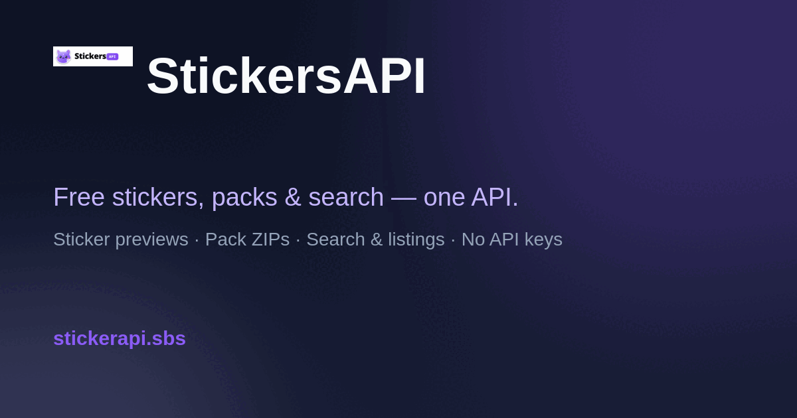
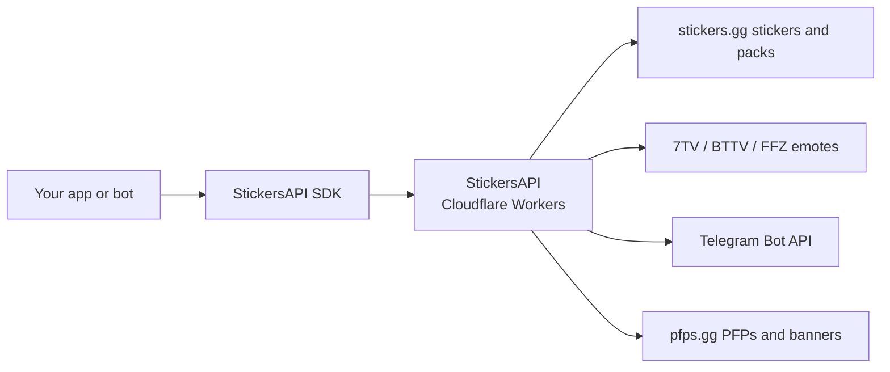
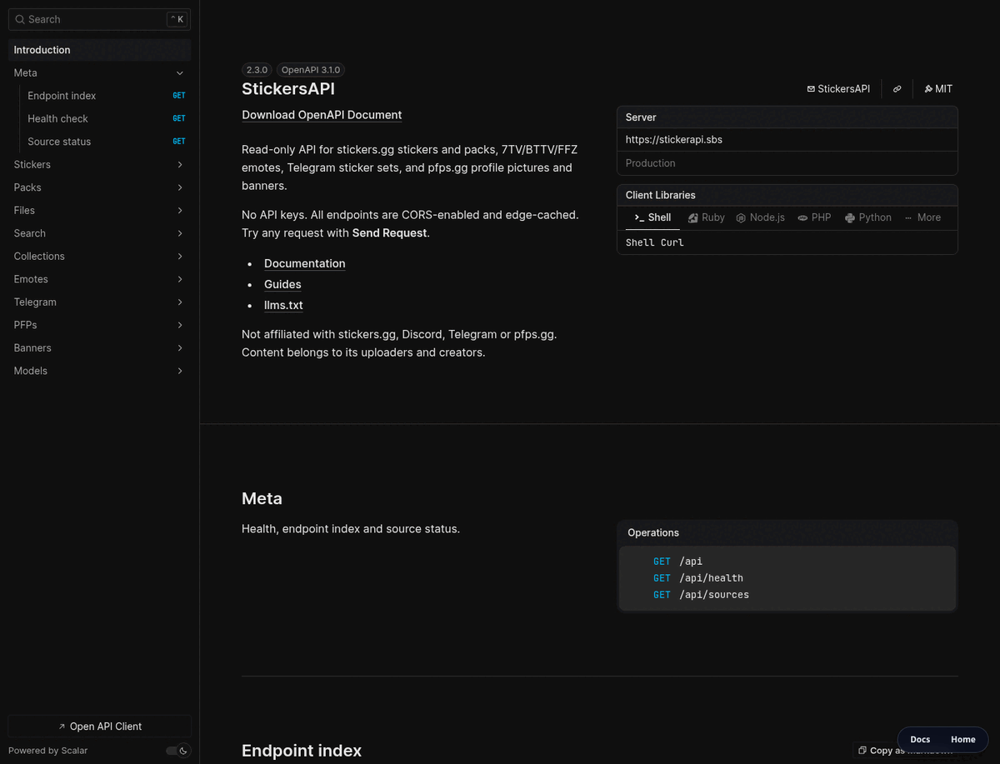
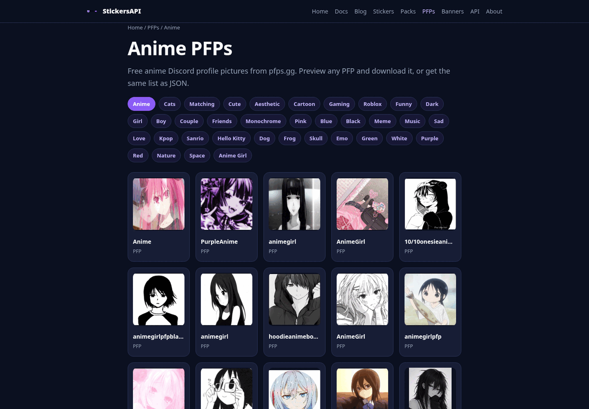

<p align="center">
  <a href="https://stickerapi.sbs/">
    
  </a>
</p>

<h1 align="center">StickersAPI</h1>

<p align="center">
  <strong>Free sticker, emote, Telegram and PFP API</strong><br />
  TypeScript SDK · Discord bot example · OpenAPI 3.1
</p>

<p align="center">
  <a href="https://stickerapi.sbs/"></a>
  <a href="https://stickerapi.sbs/docs"></a>
  <a href="https://stickerapi.sbs/reference"></a>
  <a href="https://stickerapi.sbs/api/health"></a>
  <a href="https://github.com/swadhinbiswas/stickersapi/blob/main/LICENSE"></a>
  <a href="https://github.com/swadhinbiswas/stickersapi/releases"></a>
  <a href="https://buildkite.com/"></a>
</p>

<p align="center">
  <a href="https://stickerapi.sbs/"></a>
</p>

> StickersAPI is unofficial and not affiliated with stickers.gg, Discord, Telegram or pfps.gg. Stickers, emotes, PFPs and banners belong to their uploaders and creators. The hosted API and production server code are not part of this repository.

## Highlights

- **35 API operations** for stickers, packs, search, files, emotes, Telegram, PFPs and banners.
- **No API keys, no signup.** Every public endpoint is CORS-enabled.
- **Edge-cached** on Cloudflare Workers with rate-limited search and ZIP builds.
- **Image and ZIP responses** alongside clean JSON.
- **Typed TypeScript SDK** that works in Node 18+, browsers, Workers, Bun and Deno.
- **OpenAPI 3.1** document and a Scalar-powered interactive reference.
- **Ready-to-run Discord bot** using discord.js v14.
- **MIT licensed** SDK, bot example and spec.

## Quick start

Use the SDK from the site:

```ts
import { StickersAPI } from 'https://stickerapi.sbs/sdk-assets/stickersapi-sdk.js';

const api = new StickersAPI();

const sticker = await api.getSticker('4238-cat-pee');
console.log(sticker.name);
console.log(api.stickerDownloadUrl(sticker.slug));
```

Or install it locally:

```bash
git clone https://github.com/swadhinbiswas/stickersapi.git
cd stickersapi/sdk
npm install
npm run build
```

```bash
# in another project
npm install /path/to/stickersapi/sdk
```

When the package is published to npm:

```bash
npm install @stickerapi/sdk
```

## SDK

The SDK is zero-dependency at runtime and ships typed responses. See [`sdk/README.md`](sdk/README.md) for every method.

<details>
<summary><strong>Stickers and packs</strong></summary>

```ts
const sticker = await api.getSticker('4238-cat-pee');
const pack = await api.getPack('7214-best-pepe-pack');

console.log(api.stickerPreviewUrl(sticker.slug));
console.log(api.stickerDownloadUrl(sticker.slug));
console.log(api.packZipUrl(pack.slug));
```

</details>

<details>
<summary><strong>Search, listings and random</strong></summary>

```ts
const results = await api.search('cute cat', 10);
const page = await api.listStickers({ tag: 'pepe', page: 1, sort: 'downloads' });
const random = await api.randomSticker();
const packs = await api.listPacks({ tag: 'anime', page: 1 });
```

</details>

<details>
<summary><strong>Emotes and Telegram</strong></summary>

```ts
const emotes = await api.listEmotes({ source: 'all', q: 'cat', limit: 10 });
const set = await api.getTelegramSet('UtyaDuck');

console.log(api.emotePreviewUrl(emotes.items[0].source, emotes.items[0].id));
console.log(api.telegramFileDownloadUrl(set.stickers[0].fileId));
```

</details>

<details>
<summary><strong>PFPs and banners</strong></summary>

```ts
const pfps = await api.listPfps({ tag: 'anime', page: 1 });
const pfp = await api.getPfp(pfps.items[0].slug);
const banners = await api.listBanners({ tag: 'matching', page: 1 });

console.log(api.pfpDownloadUrl(pfp.slug));
console.log(api.bannerPreviewUrl(banners.items[0].slug));
```

</details>

<details>
<summary><strong>Custom ZIP collections</strong></summary>

```ts
const response = await api.createCollectionZip([
  '2223-charlie.png',
  '8139-shocked-cat.jpg',
]);

const bytes = new Uint8Array(await response.arrayBuffer());
```

</details>

<details>
<summary><strong>Errors</strong></summary>

```ts
import { StickersAPIError } from '@stickerapi/sdk';

try {
  await api.getSticker('missing');
} catch (err) {
  if (err instanceof StickersAPIError && err.status === 404) {
    console.log('Not found');
  }
}
```

</details>

## API

**Base URL:** `https://stickerapi.sbs/api`

| Property | Value |
|---|---|
| Authentication | None |
| CORS | `*` |
| Response formats | JSON, images, `application/zip` |
| Documentation | https://stickerapi.sbs/docs |
| Interactive reference | https://stickerapi.sbs/reference |
| OpenAPI document | https://stickerapi.sbs/openapi.json |

| Group | Endpoints |
|---|---|
| Stickers | `/api/sticker/:slug`, `/api/sticker/random`, `/api/stickers`, `/api/stickers/random` |
| Packs | `/api/pack/:slug`, `/api/pack/:slug/download`, `/api/pack/random`, `/api/packs` |
| Files | `/api/file/:file/preview`, `/api/file/:file/download` |
| Search | `/api/search?q=...&limit=...` |
| Collections | `POST /api/collection/zip` |
| Emotes | `/api/emotes`, `/api/emote/:source/:id/preview` |
| Telegram | `/api/telegram/stickers/:set`, `/api/telegram/file/:id/*` |
| PFPs | `/api/pfps`, `/api/pfps/:tag`, `/api/pfp/:slug` |
| Banners | `/api/banners`, `/api/banners/:tag`, `/api/banner/:slug` |
| Meta | `/api`, `/api/health`, `/api/sources` |

```bash
# Health
curl -s https://stickerapi.sbs/api/health

# Sticker metadata
curl -s https://stickerapi.sbs/api/sticker/4238-cat-pee

# Search
curl -s "https://stickerapi.sbs/api/search?q=cute%20cat&limit=10"

# PFP listing
curl -s "https://stickerapi.sbs/api/pfps?tag=anime&page=1"

# Telegram set
curl -s https://stickerapi.sbs/api/telegram/stickers/UtyaDuck
```

## Discord bot example

`examples/discord-bot` is a complete discord.js v14 bot:

| Command | Description |
|---|---|
| `/sticker query:<slug or text>` | Fetch a sticker by slug, or search and show the top 5 |
| `/pack slug:<pack>` | Show a pack, preview and ZIP button |
| `/random` | Show a random sticker |
| `/pfp slug:<pfp>` | Show a PFP with download and page links |
| `/banner slug:<banner>` | Show a banner with download and page links |

<details>
<summary><strong>Run the bot</strong></summary>

```bash
cd examples/discord-bot
npm install
cp .env.example .env
# fill in DISCORD_TOKEN and DISCORD_CLIENT_ID
npm start
```

Invite the bot with the `bot` and `applications.commands` scopes. It needs Send Messages, Embed Links and Attach Files.

See [`examples/discord-bot/README.md`](examples/discord-bot/README.md) for the full setup.

</details>

## Repository layout

| Path | Description |
|---|---|
| `sdk/` | TypeScript SDK, source, lockfile and package metadata |
| `examples/discord-bot/` | Complete discord.js bot with env example |
| `openapi.json` | OpenAPI 3.1 document for all 35 operations |
| `assets/` | Logo, banner and screenshots for this README |
| `.buildkite/` | Buildkite pipeline, npm publish script and setup guide |
| `SECURITY.md` | Vulnerability reporting policy |
| `CONTRIBUTING.md` | Contribution guidelines |

## Architecture



The public API handles caching, coalescing, rate limits and image proxying. This repository contains the client SDK, bot example and spec, not the production Worker.

## Screenshots

<p align="center">
  <a href="https://stickerapi.sbs/reference">
    
  </a>
  <a href="https://stickerapi.sbs/pfps">
    
  </a>
</p>

## Status

| Area | State |
|---|---|
| Public API | Live at https://stickerapi.sbs/ |
| OpenAPI | 35 operations, OpenAPI 3.1 |
| SDK | 0.1.0 |
| Discord bot | discord.js v14 |
| Live endpoint checks | 45 passing |
| Runtime | Cloudflare Workers |
| CI/CD | Buildkite |

## Development

```bash
# SDK
cd sdk
npm ci
npm run build

# Bot syntax check
node --check examples/discord-bot/index.js
```

## CI/CD

The included Buildkite pipeline builds the SDK, checks the Discord bot and publishes `@stickerapi/sdk` to npm on version tags.

- Pipeline: [`.buildkite/pipeline.yml`](.buildkite/pipeline.yml)
- Publish script: [`.buildkite/publish-sdk.sh`](.buildkite/publish-sdk.sh)
- Setup guide: [`.buildkite/README.md`](.buildkite/README.md)

The pipeline expects these Buildkite environment variables:

| Name | Purpose |
|---|---|
| `NPM_TOKEN` | npm automation token with publish access |
| `NPM_USER_NAME` | expected npm user, `stickerapi` |

Release the SDK with a version tag:

```bash
cd sdk
npm version patch --no-git-tag-version
cd ..
git add sdk/package.json sdk/package-lock.json
git commit -m "release: sdk v0.1.1"
git tag v0.1.1
git push origin main --tags
```

Buildkite checks that the tag matches `sdk/package.json`, verifies the npm user, and publishes `@stickerapi/sdk` with `--access public`.

To publish the current `0.1.0` release, connect the pipeline and run a build for the existing `v0.1.0` tag.

## Security

Do not open a public issue for a vulnerability. Email **mail@stickerapi.sbs** and read [`SECURITY.md`](SECURITY.md).

Never commit `.env`, `.dev.vars`, tokens, Redis credentials or Cloudflare secrets.

## Contributing

Issues and pull requests for the SDK, bot example and OpenAPI spec are welcome. Read [`CONTRIBUTING.md`](CONTRIBUTING.md) before opening a PR.

If StickersAPI saves you time, you can:

- Star this repository.
- Use the API in a project and tell us about it.
- [Sponsor the project](https://stickerapi.sbs/sponsor).

## License

The SDK, Discord bot example and OpenAPI document are MIT licensed. The hosted service and production server code are separate and are not licensed by this repository.

Stickers, emotes, PFPs and banners remain the property of their uploaders and creators.

---

<p align="center">
  <a href="https://stickerapi.sbs/">Website</a> ·
  <a href="https://stickerapi.sbs/docs">Docs</a> ·
  <a href="https://stickerapi.sbs/reference">Reference</a> ·
  <a href="https://stickerapi.sbs/tools">Tools</a> ·
  <a href="https://stickerapi.sbs/pfps">PFPs</a> ·
  <a href="https://stickerapi.sbs/banners">Banners</a>
</p>
